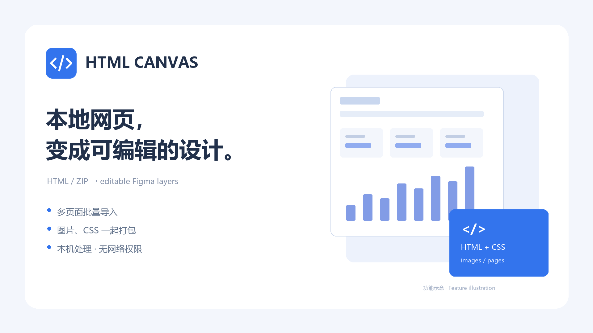

# HTML Canvas · 本地网页导入

将本地 HTML / ZIP 网站转换成可编辑的 Figma Design 图层。

Import local HTML and ZIP websites into editable Figma Design layers. A lightweight, local-first adaptation of [Builder.io/figma-html](https://github.com/BuilderIO/figma-html), licensed under MIT.



## 功能

- 导入 `.html` / `.htm`，支持多文件选择。
- 同一 HTML 的常见静态 Tab 自动拆成多个完整页面，保留公共导航与页头。
- ZIP 内的多个页面、共享 CSS、嵌套 `@import`、相对路径图片和字体资源一起处理。
- 按文件名命名页面，横向间隔 120px 排列，并避开画布已有内容。
- 提供总体进度、缺失资源提示和失败回滚。
- 尽量保留可编辑文本、字重、背景、渐变、圆角、SVG 及图片裁切。
- 纯结构容器转换为组，背景、边框、阴影及裁切容器保留画框。
- 当前插件入口无后端、统计服务、图片代理和网络权限。

## 本地构建

建议使用 Node.js 22 和 npm。项目继承了旧版构建依赖，因此安装时需要 `--legacy-peer-deps`。

```sh
npm ci --legacy-peer-deps --ignore-scripts
npm run build
```

Windows 也可双击 `build-windows.cmd`。构建脚本会为旧版 webpack 设置必要的兼容选项。

在 Figma 桌面端打开设计文件，进入 Plugins → Development → Import plugin from manifest，选择项目根目录的 `manifest.json`。

如果你要发布自己的改版，请先在 Figma 创建新插件，并把分配的新 ID 写入 manifest；不要使用本仓库的插件 ID 发布。

## 如何导入

1. 运行 HTML Canvas，设置页面宽度，默认 1920px。
2. 点击“选择 HTML / ZIP（可多选）”。
3. 单文件 HTML 请内嵌样式和图片；独立资源请保持相对目录结构，一起压成 ZIP。
4. 等待解析与图层生成，完成后画框一起出现在当前 Figma 页面。

[下载三页面测试 ZIP](examples/three-page-site.zip)，或查看 [示例网站源码](examples/site)。封面是功能示意，不是 Figma 实测截图。

示例 ZIP 目录：

```text
01-overview.html
02-orders.html
nested/03-products.htm
assets/css/main.css
assets/css/tokens.css
assets/images/product-1.svg
...
```

## 限制

- 可尝试运行内嵌脚本并捕获有限的页面状态，仍需要可在本地渲染的打包产物。
- 混用静态 Tab 标记和脚本切换的页面可能重复导出。侧边栏菜单在部分情况下只捕获首页。
- 不捕获浏览器当前页面，不支持直接输入网址；外部资源不会加载，请一起打包。
- HTML/CSS 支持是尽力还原，复杂滤镜、布局和字体可能与浏览器存在差异。
- ZIP 内字体可以辅助页面渲染，但可编辑文字仍需要 Figma 中可用的匹配字体。
- 不自动创建原型跳转，也不生成自动布局。
- 部分图标与图片会栅格化，以保留外观。
- 每个 ZIP：压缩后最大 32 MB，解压后最大 128 MB，单文件最大 32 MB，最多 1000 个条目、50 个 HTML 页面；不支持加密 ZIP。

## 一个 HTML 的多个 Tab

上传同一个文件即可自动展开已存在于 HTML 中的 Tab 内容，每个状态对应一个完整画框，并以“文件名 / Tab 名称”命名。试用 [四个 Tab 的示例](examples/four-tabs.html)，建议宽度 1440px；应导入 4 个页面。

支持 `role="tab"` + `aria-controls` / `role="tabpanel"`、常见的 `data-tab` / `data-tab-target` / `data-bs-target`、Tab 导航的 `href="#区域ID"`，以及部分内联 `showTab('区域ID')` / `switchTab('区域ID')` 写法。只读取内联处理器的字面目标，不执行函数。CSS radio Tab 可使用 `.tabs` 中的 `tab1` → `panel1` 命名或显式关联。

支持嵌套 Tab；多个独立 Tab 组会组合生成状态，每个 HTML 最多 32 种组合，超过时会要求拆分。普通文档锚点不作为页面拆分。

样式按常见 active / selected 状态尽力还原；支持 `data-figma-display="grid"` 等属性指定强制展开时的布局类型。

### 脚本驱动的 Tab / 筛选按钮

带脚本的页面会在隔离沙箱中运行，并尝试依次点击识别出的单选控件组。插件设置可以关闭自动切换，每个已捕获的状态会生成一个画框。识别参考 `aria-selected`、`aria-pressed`、`aria-current`、`data-state`、常见选中 class 及样式差异，也支持同名 radio 组和不超过 8 项的 `<select>`。

每次点击后会等待点击触发的定时器（如“加载中…”之后再出内容）完成、DOM 稳定后再截取，点完一组会恢复原选中项再处理下一组。只切换页面初始时可见的控件组，不做多组组合，也不进入切换后才出现的下一级控件；每个 HTML 最多 20 个脚本状态。需要登录才能显示的页面不会自动跳过登录。[`local-test/script-states/`](local-test/script-states/) 中有 8 种写法的测试页。

## 为什么导入后是空白？

“单文件 HTML”不一定是静态页面。React/Vue 打包产物可能只有一个空的 `#root` / `#app`，内容依靠 JavaScript 运行后才生成。插件会尝试在隔离沙箱中运行内嵌脚本。依赖网络请求、外部脚本或登录的页面仍可能得到空白或不完整的结果。

遇到这种情况，请从原项目导出包含实际正文节点的预渲染 HTML，再导入。常见的空挂载页面会报错。包含完整正文的 SSR 页面可以进入解析流程。

## 测试

```sh
npm run test:local
```

覆盖 Tab 状态、ZIP 资源打包、批量导入 UI、解析清理、字体匹配、临时构建与分组、图片裁切、背景、变换及图标等十组检查。

还原度可用浏览器对照检查：运行 `npm run preview`，打开 `http://localhost:8765/preview.html?file=fidelity.html&width=900`，左侧是原始 HTML，右侧是按解析出的图层绘制的结果。把要检查的 HTML 放进 `local-test/` 并修改 `file` 参数即可。`fidelity-2.html` 覆盖变换、圆锥/重复渐变、clip-path、outline、混合模式、文字换行与省略号、CSS 计数器；加上 `&fonts=Arial,Inter` 可模拟 Figma 已有的字体列表，检查缺失网页字体转图片的效果。测试使用 Node DOM 解析和模拟浏览器 / Figma API；真实 Figma 显示效果仍需要人工回归。仓库不宣称已通过 Figma 审核。

## 项目结构

```text
plugin/ui.tsx                      轻量 UI 入口
plugin/code.ts                     Figma 插件主入口
plugin/functions/zip-files.ts      ZIP 与资源内嵌
plugin/functions/local-html.ts     静态 HTML 渲染
plugin/functions/local-canvas-import.ts  临时构建、分组与批量提交
lib/html-to-figma/                 HTML → 图层解析器
local-test/                       本地回归检查
tools/                            构建与发布打包脚本
examples/                         三页面测试网站
```

`legacy-ui.tsx`、`legacy-code.ts`、旧 AI / 自动布局相关模块和浏览器扩展源码保留作历史参考，不属于当前插件的活动入口。安装依赖列表仍包含旧模块的开发依赖；生产包不加载其统计或代理逻辑。

## 隐私与许可

文件在插件内存中处理，当前 manifest 声明 `No network access`。导入结果写入 Figma 文档后，仍由 Figma 正常存储、同步和共享。详见 [隐私说明](PRIVACY.md)。

本项目基于 Builder.io 的 MIT 项目修改，保留原版权和 [MIT 许可证](LICENSE.md)。这不是 Figma、Builder.io 或 html.to.design 的官方产品。

反馈可提交 GitHub Issue，或联系 l1781874099@gmail.com。
